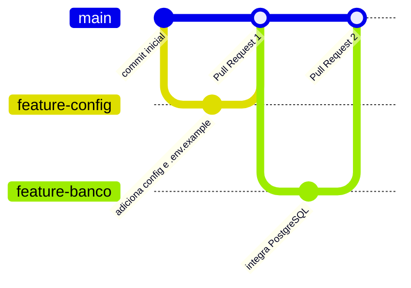
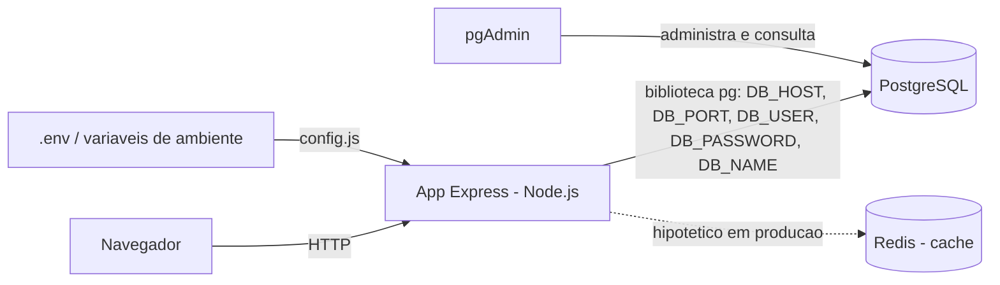

# projeto-express

API de **pessoas** (cadastrar, listar, alterar e remover) feita com **JavaScript + Express.js** e **PostgreSQL**, com uma página HTML simples para usar a API.
Projeto da disciplina *Padrões de Projeto, Frameworks e API*, aplicando os **4 primeiros fatores do Twelve-Factor App**.

## Como executar

Requisitos: Node.js 20 ou superior e PostgreSQL (com pgAdmin) instalado e rodando.

1. No pgAdmin, crie um banco de dados vazio chamado `projeto_express`.
2. No terminal, dentro da pasta do projeto:

```bash
npm ci                  # instala EXATAMENTE as versões do package-lock.json
cp .env.example .env    # PowerShell: Copy-Item .env.example .env
# edite o .env e coloque a senha do SEU PostgreSQL em DB_PASSWORD
npm start
```

3. Abra <http://localhost:3000/>.

A tabela `pessoas` é criada automaticamente na primeira execução, com 3 pessoas iniciais.

## Estrutura do projeto

```
projeto-express/
├── server.js            # ponto de entrada: monta o app, testa o banco e liga o servidor
├── config.js            # único arquivo que lê variáveis de ambiente (Fator 3)
├── db.js                # conexão com o PostgreSQL e criação da tabela (Fator 4)
├── router/
│   └── pessoas.js       # rotas /pessoas, com os comandos SQL
├── public/              # frontend estático
│   ├── index.html
│   └── css/estilo.css
├── docs/
│   └── DOCUMENTO-4-FATORES.md
├── package.json         # dependências e scripts (Fator 2)
├── package-lock.json    # versões exatas travadas (Fator 2)
├── .env.example         # modelo de configuração (Fator 3)
└── .gitignore           # impede enviar node_modules e .env ao GitHub
```

## Rotas

| Método | Rota           | O que faz                                  |
|--------|----------------|--------------------------------------------|
| GET    | `/pessoas`     | lista todas                                |
| GET    | `/pessoas/:id` | busca uma pessoa                           |
| POST   | `/pessoas`     | cria (JSON: nome, idade, cidade)           |
| PATCH  | `/pessoas/:id` | altera só os campos enviados               |
| DELETE | `/pessoas/:id` | remove                                     |
| GET    | `/saude`       | mostra a configuração em uso e o status do banco (sem senhas) |

## Fluxo de branches (GitHub Flow)

- `main` é sempre estável; ninguém commita direto nela.
- Cada tarefa nasce numa branch curta, vira Pull Request e é mesclada na `main`.



## Mesmo código em desenvolvimento, homologação e produção

O código é o mesmo; muda só a configuração (variáveis de ambiente):

| Ambiente        | Código                          | Configuração                                   |
|-----------------|---------------------------------|------------------------------------------------|
| Desenvolvimento | sua máquina                     | arquivo `.env` local                           |
| Homologação     | branch `main`                   | variáveis do servidor (`NODE_ENV=staging`, banco de testes) |
| Produção        | tag da `main` (ex.: `v1.0.0`)   | variáveis do servidor (`NODE_ENV=production`, banco de produção) |

## Arquitetura simplificada



Linha contínua = implementado. Linha tracejada = serviço previsto para produção, não implementado.
O pgAdmin é apenas uma ferramenta visual para o desenvolvedor acessar o mesmo banco.

Veja o documento explicativo em [`docs/DOCUMENTO-4-FATORES.md`](docs/DOCUMENTO-4-FATORES.md).
